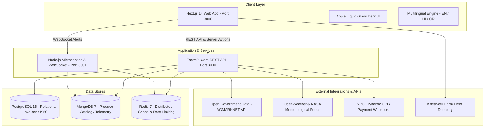

# KrishiConnect (कृषि कनेक्ट)

**Pan-India Agricultural Exchange & Farm-Gate Operating System**

KrishiConnect is an open, full-stack B2B agricultural commerce platform engineered to eliminate information asymmetry, unorganized brokerage, and distress selling across Indian agriculture. 

The platform directly integrates Government of India AGMARKNET daily mandi price feeds, shared farm machinery and drone fleet rentals, highway freight corridor routing, cold storage chamber telemetry, and instant GST-compliant digital invoicing with dynamic UPI settlement.

---

## Core Capabilities

| Module | Core Functionality | Data Source / Standard |
|---|---|---|
| **Live Mandi Intelligence** | Daily APMC modal rates, wholesale-to-retail spread analysis, 7-day price trajectory, and live arrival volumes across 28 states | Government of India AGMARKNET (`data.gov.in`) |
| **Machinery & Equipment Fleet** | On-demand rentals of verified tractors, combine harvesters, laser levelers, and UAV spray drones at transparent per-acre and hourly rates with zero brokerage | KhetiSetu Verified Farm Fleet Network |
| **Smart Freight Corridors** | Route mileage calculation, highway toll projections, and transparent per-kilometer carrier pricing for 1.5T to 25T freight vehicles | National Highway Corridors & APMC Logistics Network |
| **Preservation & Cold Storage** | District chamber locator with real-time temperature telemetry, relative humidity, and available quintal capacity tracking to eliminate distress sales | Certified National Horticulture Board (NHB) Chambers |
| **Digital GST Invoicing & UPI** | Instant generation of GST-compliant e-invoices with dynamic NPCI UPI QR codes for zero-friction mobile settlement | NPCI Dynamic UPI Specification & GST Tax Engine |
| **Soil Health & Scientific Advisory** | Accredited laboratory testing directory with doorstep collection and crop-specific fertilizer dosage calculations | ICAR Agronomic Dosage Models |
| **Multilingual Architecture** | Instant client-side language switching (English, Hindi, Odia) without page reload latency | React Context Localization Engine |

---

## System Architecture



---

## Tech Stack

- **Frontend**: Next.js 14 (App Router), TypeScript, Tailwind CSS, Lucide React, Recharts (3D Perspective Charts).
- **Backend Services**: FastAPI (Python 3.11+), SQLAlchemy 2.0 (Async), Pydantic v2.
- **Microservices**: Node.js, Express, WebSocket (`ws`).
- **Databases**: PostgreSQL 16 (Relational & Auth), MongoDB 7 (Commodities & Analytics), Redis 7 (Caching & Pub/Sub).
- **External Feeds**: Open Government Data (`data.gov.in`) AGMARKNET REST API, OpenWeatherMap, Razorpay/UPI.
- **Orchestration**: Docker & Docker Compose.

---

## Quick Start (Docker Compose)

### Prerequisites
- [Docker](https://docs.docker.com/get-docker/) (v24+) & [Docker Compose](https://docs.docker.com/compose/) (v2.20+)

### 1. Clone & Configure Environment

```bash
git clone https://github.com/the-brat-kid/KrishiConnect.git krishiconnect
cd krishiconnect

# Copy environment template
cp .env.example .env
```

> **Security Note:** Open `.env` and fill in your secure passwords, secrets, and API credentials before starting the application. Do not commit `.env` to version control.

### 2. Start All Services

```bash
docker-compose up --build -d
```

This boots the complete stack:
- **Frontend (Next.js):** http://localhost:3000
- **Backend API (FastAPI Docs):** http://localhost:8000/docs
- **Node.js Microservice:** http://localhost:3001/health
- **PostgreSQL Database:** Port 5432
- **MongoDB Database:** Port 27017
- **Redis Cache:** Port 6379

---

## Local Development (Without Docker)

### 1. Backend (FastAPI)
```bash
cd backend-fastapi
python -m venv venv
source venv/bin/activate
pip install -r requirements.txt
uvicorn app.main:app --reload --port 8000
```

### 2. Microservice (Node.js)
```bash
cd backend-node
npm install
npm run dev
```

### 3. Frontend (Next.js)
```bash
cd frontend
npm install
npm run dev
```

Open http://localhost:3000 to interact with the platform.

---

## Environment Configuration

Configure your environment variables in `.env`. All database passwords, tokens, and private API keys must be kept confidential:

| Variable | Description | Example / Recommended Value |
|---|---|---|
| `DATABASE_URL` | PostgreSQL async connection string | `postgresql+asyncpg://<db_user>:<db_password>@localhost:5432/<db_name>` |
| `MONGODB_URL` | MongoDB connection string | `mongodb://<mongo_user>:<mongo_password>@localhost:27017/<db_name>?authSource=admin` |
| `REDIS_URL` | Redis cache connection string | `redis://localhost:6379/0` |
| `SECRET_KEY` | Application secret key for token signing | Generate via `openssl rand -hex 32` |
| `JWT_SECRET` | Secret key for JWT authentication | Generate a long random secret |
| `DATA_GOV_API_KEY` | Open Government Data (`data.gov.in`) API key | Your registered Data.gov.in API key |
| `MERCHANT_UPI_ID` | Virtual Payment Address for dynamic UPI QR generation | `your_business@upi` |
| `MERCHANT_UPI_NAME` | Business / FPO display name on UPI apps | `KrishiConnect Exchange` |
| `RAZORPAY_KEY_ID` | Razorpay API Key ID (Optional) | `rzp_test_your_key` |
| `RAZORPAY_KEY_SECRET` | Razorpay API Secret (Optional) | Your Razorpay API secret |
| `GEMINI_API_KEY` | Google Gemini API Key (Optional fallback) | Your Gemini API key |

---

## Directory Structure

```
krishiconnect/
├── frontend/                     # Next.js 14 App Router Frontend
│   ├── app/                      # Application routes
│   │   ├── (auth)/               # Login & Register
│   │   └── (dashboard)/          # Mandi Rates, Equipment, Logistics, Cold Storage, Invoices
│   ├── components/               # Modular UI, modals, and design system
│   │   ├── crops/                # Crop detail & pricing modals
│   │   ├── equipment/            # Machine cards & comprehensive detail modal
│   │   ├── cold-storage/         # Cold storage booking modal & cards
│   │   ├── layout/               # Dynamic weather canvas, header & notification bell
│   │   └── ui/                   # Liquid-glass primitives & controls
│   ├── hooks/                    # Live AGMARKNET query hooks & notification engine
│   └── lib/                      # Region/Language context, APMC datasets & utils
│
├── backend-fastapi/              # FastAPI High-Performance Backend
│   ├── app/
│   │   ├── api/routes/           # Invoices, produce, payments, and auth endpoints
│   │   ├── core/                 # Security, database configuration & caching
│   │   ├── models/               # SQLAlchemy ORM models
│   │   └── schemas/              # Pydantic validation schemas
│   └── alembic/                  # Database migration scripts
│
├── backend-node/                 # Node.js WebSocket & Telemetry Microservice
│   └── src/
│       ├── routes/               # Microservice REST endpoints
│       └── websocket/            # Real-time advisory & alert broadcaster
│
├── docker-compose.yml            # Container orchestration specification
├── .env.example                  # Sanitized environment variable template
└── README.md                     # Project documentation
```

---

## Security & Data Privacy

- **Zero Hardcoded Secrets**: All database connection credentials, JWT secrets, and external API keys are loaded strictly via environment variables.
- **Fail-Safe Data Caching**: Mandi data queries implement a 3.5-second strict timeout with in-memory caching to prevent upstream API blocking and guarantee low-latency page loads.
- **Idempotent Webhooks**: All payment webhooks implement cryptographic HMAC SHA-256 signature verification to prevent replay attacks and duplicate reconciliations.

---

## License

This project is licensed under the [MIT License](LICENSE) — free for educational, commercial, and personal use.
